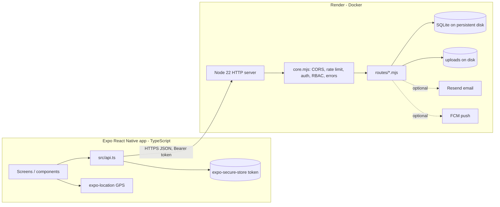
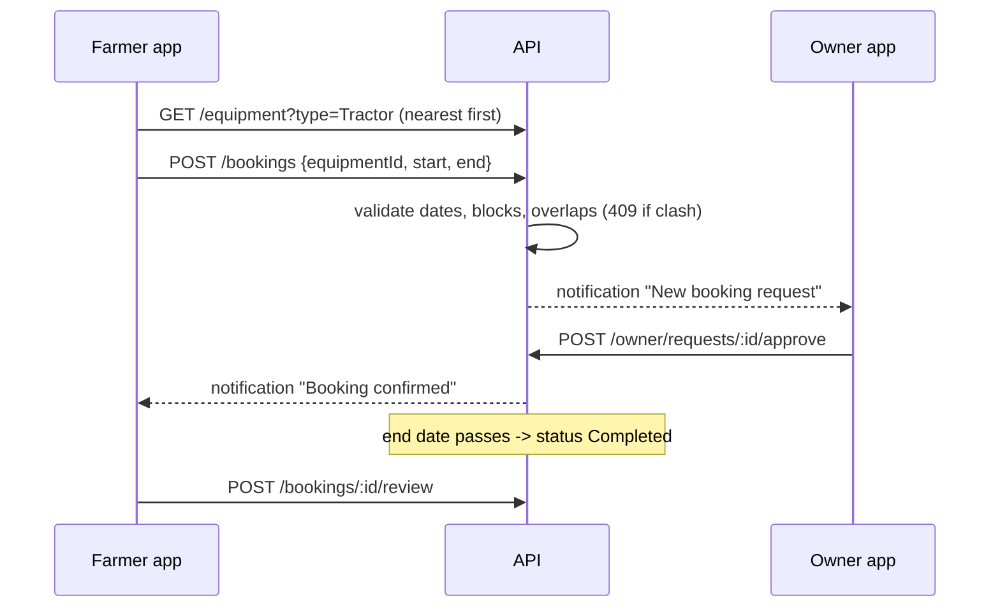
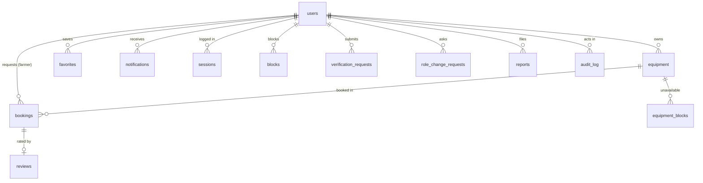

# AgriShare - System Documentation (MVP 1)

## 1. Purpose
Small and emerging farmers in South Africa often cannot afford their own tractors or harvesters. Equipment owners have idle machines.
AgriShare connects them: a farmer finds equipment (optionally with a skilled operator) near their farm, requests dates, and the owner approves.
Payment is **out of scope** - parties settle directly.

## 2. Users and roles
| Role | Can do |
|---|---|
| Farmer | Browse/search by type, distance, province; save favourites; request, cancel and review bookings; find operators |
| Equipment Owner | List equipment with photos and daily rate; block dates; approve/decline requests; dashboard; get verified badge |
| Operator | Publish operator profile (years, certificates, skills, day rate, availability) |
| Admin | Moderate users, listings, reports, support tickets, verifications, role-change requests; audit log |

**Implementation status (honest summary).** The backend implements the full feature set below (75 endpoints, tested). The MVP 1 mobile app has screens for the core marketplace loop - browse/search, location, details, booking request/cancel, owner dashboard (approve/decline, add/pause/delete equipment), operator directory, profile (edit, change password, account-type request) and admin (overview, users, role requests). Features marked *API only* in section 9 have no screen yet.

## 3. Architecture

- **Mobile app** (`app/`): Expo SDK 58, React Native, TypeScript strict. Single-page tab navigation (Browse, Bookings, My Equipment, Operators, Profile, Admin) driven by role. Modals for details, auth, add-equipment and location picker.
- **Backend** (`backend/`): Node.js 22, no npm runtime dependencies. Built-in `node:sqlite`. Routes registered declaratively with role guards and rate limits.
- **Hosting**: Docker container on Render with a persistent disk for the database and photos. The mobile app is distributed as an APK built with EAS Build.

## 4. Key flows

Booking states: `Pending -> Confirmed -> Completed`, or `Declined / Cancelled / Expired`.

## 5. Data model (SQLite, schema version 6)

All tables: users, sessions, one_time_tokens, recovery_codes, equipment, equipment_blocks, bookings, reviews, favorites, notifications, devices, support, verification_requests, role_change_requests, reports, blocks, audit_log.
Foreign keys are enforced; deleting a user cascades to their data.

## 6. Security and privacy
- Passwords: scrypt + salt, min 10 chars with letter and number. Sessions: random 256-bit tokens stored as SHA-256 hashes, 30-day expiry; mobile token kept in secure storage (Keychain/Keystore).
- Role-based access control on every protected route; admin 2FA (TOTP) enforced in production.
- Rate limiting per IP/user on auth and write endpoints; request-size limits; parameterised SQL only.
- Public listings expose an approximate location (~3 km); exact location only after a confirmed booking.
- Uploaded images type-checked from bytes and EXIF stripped; ID documents admin-only and deleted after decision.
- POPIA support: consent at sign-up, data export (`GET /account/export`), account deletion, block/report tools. Details: `backend/SECURITY.md`.

## 7. Non-functional notes
- Zero runtime dependencies on the server keeps supply-chain risk and cold-start time low.
- Health endpoints `/healthz`, `/api/health`; structured JSON logs without secrets; optional error webhook; `npm run backup` for DB snapshots.
- Distance ranking uses the haversine formula against a built-in list of South African towns; GPS via `expo-location`.

## 8. Testing
| Layer | Tool | Result |
|---|---|---|
| API integration | `backend/tests/api.test.mjs` (auth, cookies/CSRF, RBAC, dates, bookings, reviews, verification, 2FA, privacy) | 98/98 pass |
| API contract | Postman collection `docs/postman` (52 requests with assertions) | 52/52 pass against a live instance |
| App type safety | `npm run typecheck` in `app/` | run before release |
| Manual | Test script in `docs/BUILD_AND_DEPLOY.md` section 6 | to be signed off on the device |

## 9. Known limitations / next steps
**API ready, no app screen yet (43 of 70 client methods in `app/src/api.ts` are unused):** leave a review after a completed hire; report listing/user and block user; operator profile editing; owner date-blocking; forgot/reset password and email verification; 2FA set-up; data export and account deletion; support tickets; notifications list; verification upload; admin screens for listings, bookings, reports, tickets, verifications and audit log. Each is a thin screen over an existing, tested endpoint.

**Other:** No in-app payments or chat; no push delivery until FCM keys are configured; email needs a Resend key for production verification; photo storage is on local disk (move to object storage to scale beyond one instance); iOS builds need an Apple Developer account.
